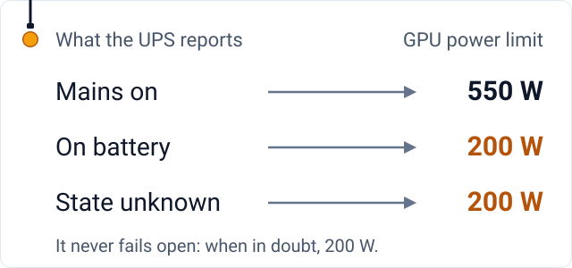

# hostops

**A worked example for one machine.** When the mains fails, a GPU at full power empties a UPS battery in minutes.
hostops drops the GPU's power limit the moment the UPS reports the cut, and keeps a ledger: a SQLite log of the cuts
and the power draw.

<picture>
  <source media="(prefers-color-scheme: dark)" srcset="assets/states-dark.svg">
  
</picture>

"Never fails open" means that when it cannot read the UPS, it picks the low limit.

## One cut, as the daemon logged it

A cut on 17 October, from the daemon's own log, with times counted from the cut. This machine runs its own tuned
limit values, so they are left out.

| When | What happened |
|---|---|
| t+0 s | The UPS reports battery: load 39%, the power supply drawing 602 W, 540 s of runtime left. The daemon sets the battery limit in the same second. |
| t+132 s | Mains is back: load 20%, the power supply drawing 288 W, battery at 94%, 1,200 s of runtime left. The mains limit returns in the same second. |

The ledger on this machine holds 16 cuts in the 30 days to 21 October.

## How it works

- **`ups-gpu-power` waits for the UPS to speak.** The UPS (a CyberPower OLS2000EC on USB) pushes a status report the
  instant it moves to battery, so a blocking read reacts in milliseconds; a cron job would leave the GPU at full power
  for the whole polling interval. It runs as root, to set the GPU's power limit through nvidia-smi and to open the UPS's USB device.
- **`power-ledger` writes it down.** A row every 60 s on mains and every 5 s on battery, plus one the moment the UPS
  status changes. It only reads the UPS.

## Why these numbers

- **550 W, not 600 W:** on 2026-09-11 the card dropped off the bus, losing its PCIe link until a reboot, 3 min 52 s
  after its limit went from 550 to 600 W under full load. 550 W ran about 1.5 h clean under the same stress.
- **200 W on battery:** at idle the machine draws about 310 W, and the UPS then reported 18 minutes of battery
  (2026-09-21). A busy GPU roughly triples that load.

These are the repository's defaults, at the top of `bin/ups-gpu-power`. [The policy and the reasons](docs/UPS-GPU-POWER.md)
are one page.

## Limits

- One UPS model: the udev rule, the Linux rule that lets the service open the UPS's USB device, matches only it.
- `install.sh` runs `power-ledger` as the user `pctablet505`, and the doc uses this machine's paths: edit both.
- No licence file yet, so ask before reusing the code.
- It protects battery runtime, not the UPS rating.
- Not measured: the battery runtime at the 200 W limit, and how much slower GPU work runs under it.

---

<picture><source media="(prefers-color-scheme: dark)" srcset="assets/mark-dark.svg"></picture>
**Real numbers, failures left in.** One of the [tools of RL Alpha Labs](https://rlalphalabs.com/tools/), built by [pctablet505](https://github.com/pctablet505).
